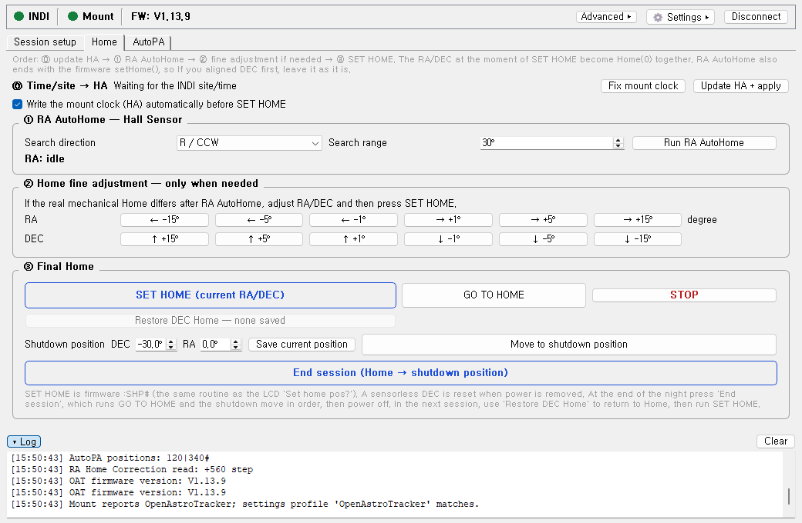
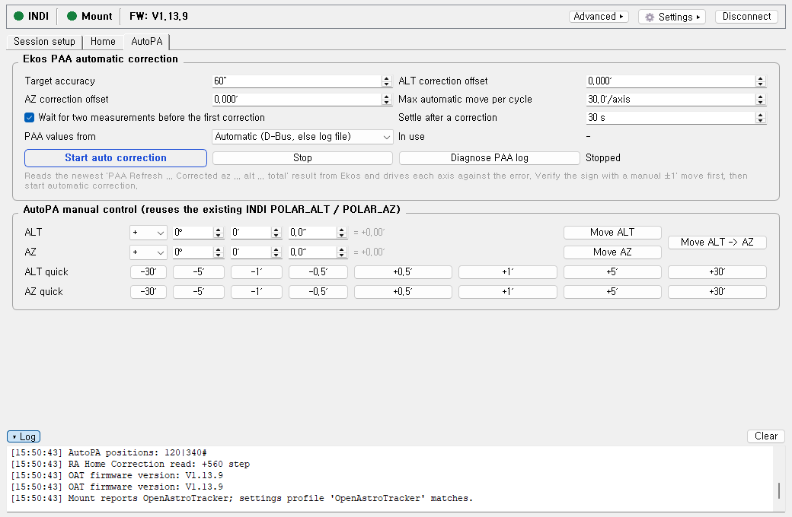
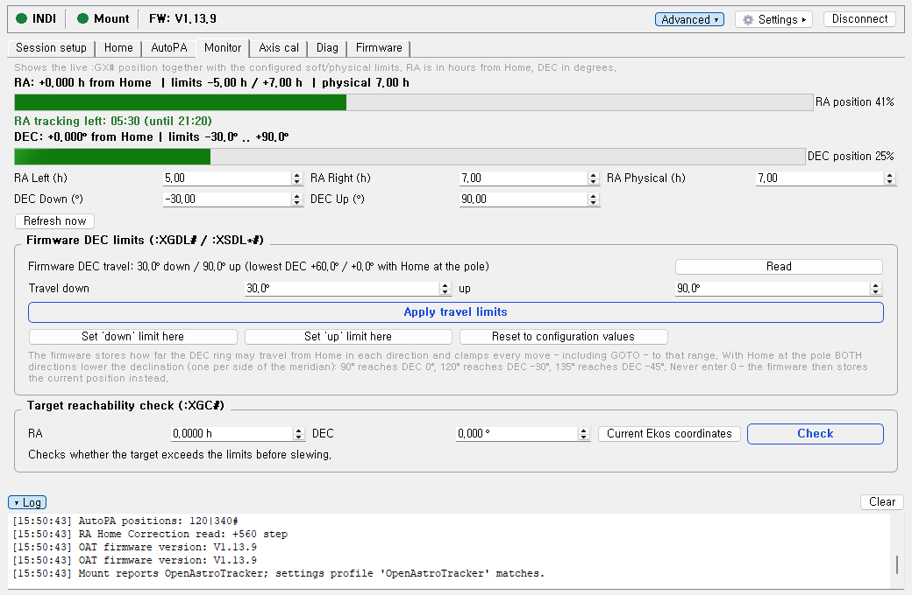
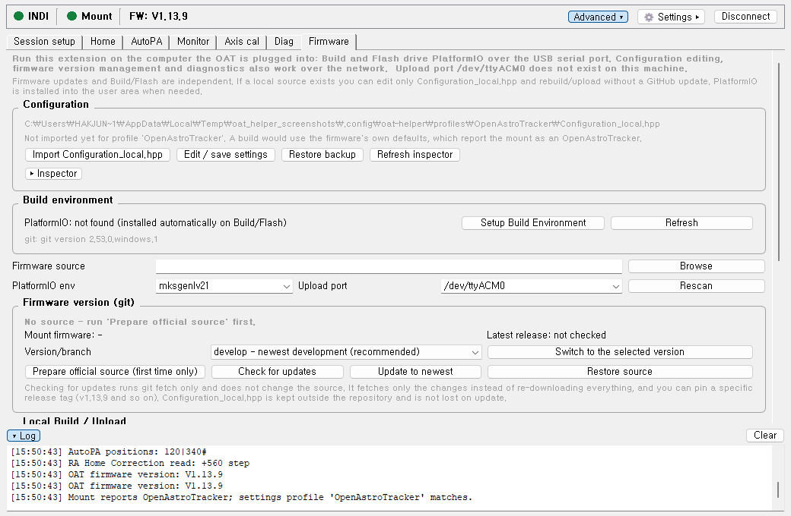

# OAT Helper

A KStars/Ekos extension for the [OpenAstroTracker](https://openastrotech.com/)
(OAT/OAM), aimed at Linux users who run their mount from KStars/Ekos — on a
Raspberry Pi, Astroberry, StellarMate or a desktop.

Everything needed during a session lives inside Ekos: homing, a shutdown
position, firmware maintenance, and automatic polar-alignment correction driven
by Ekos' own PAA measurements - including the parts a sensorless-DEC OAT needs
every night.

> **Unofficial community project.** Not affiliated with or endorsed by
> OpenAstroTech. It commands real hardware — read the safety notes below.



*The Home tab: the nightly sequence in order — mount clock, RA AutoHome, fine
adjustment, SET HOME, and one button to close the session down.*

## What it does

**Observing** — the three tabs you normally see.

- Session setup wizard, with the polar-axis altitude computed from the site
  Ekos reports (Seoul 37.57°N → tilt the RA axis 37.6°)
- HA/time sync that writes and verifies the mount's sidereal time (a stale one
  makes GOTO flip across the meridian), RA Hall AutoHome, manual DEC home,
  SET HOME, GO TO HOME
- Shutdown ("release") position so the camera's weight does not rest on the RA ring
- Saved DEC Home restore — no re-aiming DEC after a power cycle
- AutoPA: reads Ekos' Polar Alignment Assistant refresh results — straight from
  KStars over D-Bus, or from the log file — and drives the ALT/AZ motors
  automatically, with a settle window, direction, per-axis and runaway guards
- Sidereal rate trim (slewing, direction buttons and slew rate are Ekos' own
  Mount tab, so they are not duplicated here)
- Mount monitor with the firmware's own DEC limits, target reachability check
- Plate-solve axis calibration that can write steps/degree back to the mount,
  plus the one-off motor direction checks
- Read-only diagnostics

The window opens with three tabs; the rest is behind the **Advanced** toggle.



*AutoPA reads each Ekos PAA Refresh result and drives ALT/AZ against the error.
"Settle after a correction" covers one capture+solve cycle so the same
measurement is never applied twice.*



*The mount monitor. "RA tracking left" is the one that decides how long a
sequence can run: the OAT cannot flip across the meridian, so it is shown as a
time of day as well as a countdown.*

**Firmware maintenance** — behind the Advanced toggle, and only on the machine
the OAT is plugged into (the tab hides itself elsewhere).

- `Configuration_local.hpp` import / edit / backup / restore
- git-based firmware version management: incremental updates, release-tag
  pinning, source restore, latest-release check
- PlatformIO auto-install, build, flash — offers to disconnect the mount so the
  serial port is free and reconnects it afterwards, with live output, a progress
  bar and a Cancel button
- Guarded factory reset



*Firmware maintenance. The banner says plainly when this machine is not the one
holding the USB cable, and it warns that the configured upload port is absent
rather than failing halfway through a flash.*

## Requirements

- KStars/Ekos **3.7.3 or newer** (the Extensions feature)
- INDI driver **LX200 OpenAstroTech** (libindi 2.0.4+ recommended)
- OpenAstroTracker firmware **v1.13.x** (tested against v1.13.9; features are
  gated by the version reported by `:GVN#`)
- Python 3 and PyQt5 (`sudo apt-get install python3-pyqt5`)
- Qt's D-Bus bindings (`PyQt5.QtDBus`, shipped inside `python3-pyqt5`) so
  AutoPA can read the PAA results directly from KStars; without them AutoPA
  falls back to parsing the Ekos log file
- `git`, for firmware version management — optional, but without it updates
  re-download the whole source and release tags cannot be pinned. The Firmware
  tab reports whether it is installed.

## Install

```bash
git clone https://github.com/<you>/oat-ekos-helper.git
cd oat-ekos-helper
chmod +x install.sh
./install.sh
```

Restart KStars completely, then start `oat_helper` from
**Ekos Summary → Extensions**. If you used the earlier `oat_tools` /
`oat_firmware` extensions, the installer removes them and their settings are
migrated on first start.

The installer detects native, Flatpak and Snap KStars data directories, installs
the launcher as the only executable file (KStars treats every executable in its
extensions folder as an extension), and prints a self-check for each one.

## Where to run it

Ekos starts an extension as a child process, so **the extension always runs on
the machine KStars runs on**. It then talks to the mount over INDI's network
protocol as a second client, which means the mount itself can be somewhere else.

| Setup | Observing tabs | Firmware tab |
| --- | --- | --- |
| KStars + INDI + mount all on the Pi (VNC to it) | yes | yes |
| KStars on a laptop, INDI + mount on the Pi | yes — set Host to the Pi | hidden (no serial port here) |
| Script started by hand, no KStars | yes, with a note below | only where the USB cable is |

**Remote INDI.** Open **Connection** and set Host to the machine running
`indiserver` (default `127.0.0.1`, port 7624). Everything that commands the
mount — homing, SET HOME, Park, shutdown position, AutoPA moves — works across
the network.

**AutoPA talks to KStars directly.** The Polar Alignment Assistant values
arrive over the session D-Bus bus (`org.kde.kstars.Ekos.Align`), so nothing has
to be configured: no Ekos file logging, no log path. The AutoPA tab shows which
source is in use.

If D-Bus is unavailable — no session bus, no `PyQt5.QtDBus`, or Ekos' Align
module was never opened — it falls back to parsing the KStars log file and
says so in the log. That path needs Ekos file logging on. If you start
`oat_helper.py` by hand on a different machine than KStars, share the KStars
`logs` folder and point `ekos_log_dir` in `~/.config/oat-helper/config.json`
at it.

**One correction per measurement.** An Ekos capture+solve takes about 25 s, so
the refresh result that appears right after a correction still describes the
error from *before* the move. "Settle after a correction" (30 s by default)
makes AutoPA wait that out rather than applying the same correction twice and
oscillating.

**Flashing is local only.** Build and Flash drive PlatformIO over the USB serial
port, so the Firmware tab is hidden unless this machine has a serial device
(override with `always_show_firmware_tab` in the config). The tab also carries a
banner and warns when the configured upload port does not exist here. Editing
`Configuration_local.hpp`, managing firmware versions and reading diagnostics
work from anywhere.

**Settings are per mount, per machine.** The same helper drives an
OpenAstroTracker, an OpenAstroMount and an OpenAstroExplorer — they run the same
firmware through the same INDI driver — but almost everything it stores belongs
to one specific mount: the DEC Home travel, the shutdown angle, the travel
limits, `Configuration_local.hpp`, which PlatformIO environment and port to
flash. So the whole config lives under a profile named after what the mount
reports for `:GVP#`:

```
~/.config/oat-helper/
  active_profile
  profiles/oat-pier/{config.json, Configuration_local.hpp, backups/}
  profiles/oae-field/{config.json, Configuration_local.hpp, backups/}
```

A profile is named whatever you call it, and says which mount model it is for
in a `model` field — `OpenAstroTracker`, `OpenAstroMount` or
`OpenAstroExplorer`, as `:GVP#` reports them. Naming profiles after the model
would allow only one per model: no second Tracker, and no way to keep a working
configuration beside the one you are changing.

Nothing is shared between profiles. **New profile…** starts from the defaults,
because that is a different mount; **Copy this profile…** brings everything
along, including the measured DEC Home travel, because that is the same mount
set up differently. Both are in the **Settings → Mount profile** list, and
loading one needs a restart.

On connect the model is matched against the `model` field. One profile for the
reported model is an answer and the helper names it; two are a question, so it
names them both and changes nothing rather than picking a set of numbers for
your mount. Until you switch, the pages that move the mount are disabled — one
mount's DEC Home travel replayed on another is a move into the frame.

The Firmware page stays reachable throughout: it holds the configuration
editor, which is how a mix-up gets sorted out, and flashing does not move the
mount. Its BUILD and FLASH buttons carry the restriction instead.

### The first flash of a new board

Detection cannot bootstrap a profile, only confirm one. A board with no
firmware on it has no LX200 responder, so the INDI driver cannot even complete
its handshake and `:GVP#` never happens. Nothing is blocked in that state —
that is the point, because a board that cannot identify itself is a board that
still has to be flashed.

So the first time is deliberately manual:

1. **Settings → Mount profile** → pick the mount, restart. The profile is
   created from the defaults.
2. **Firmware** tab: import a `Configuration_local.hpp` that defines the mount
   (`OAE` for an Explorer, `OAM` for a Mount, neither for a Tracker), set the
   PlatformIO environment (`oaeboardv1` for the Explorer's ESP32 board,
   `mksgenlv21` and friends for the AVR boards) and the serial port.
3. **BUILD → FLASH**.
4. Reconnect. `:GVP#` now answers, and the profile is confirmed in the log.

The environment picks the *board*; a define picks the *product*. The firmware
returns `OpenAstroExplorer` from `:GVP#` only for `#define OAE` — build an
Explorer board without it and you get a firmware that calls itself an
OpenAstroTracker and applies Tracker travel limits to Explorer hardware. The
helper compares the profile, the environment and that define before building
and says so if they disagree; it asks the mount nothing, so the check works
before the first flash, and it warns rather than refusing.

Flashing always needs the USB cable — the firmware has no over-the-air upload
path, so the Explorer's WiFi link cannot carry one.

Builds run with `PLATFORMIO_BUILD_SRC_FLAGS=-Wno-error`. Upstream compiles with
`-Werror`, and the xtensa toolchain the Explorer's ESP32 build uses warns about
things the AVR toolchain does not, so `oaeboardv1` fails from a clean checkout
while the AVR environments succeed. GCC takes the last of `-Werror` and
`-Wno-error`, so the promotion is off and the warnings still print. Editing
`platformio.ini` instead would be undone by "Update to newest" and conflict on
every source update.

### Controls follow the firmware

One Pi drives both mounts by swapping the board, so the same pages are offered
to very different hardware. On connect the helper reads `:XGM#` — the
firmware's own list of what it was built with — and disables what is not there,
with the reason on the tooltip. A mount with no hall sensor on RA gets no RA
AutoHome button; one built without the AutoPA steppers gets no AutoPA page.

Two caveats are built in. `:XGM#` describes the **build**, not the hardware:
`AZ_STEPPER_TYPE` and `ALT_STEPPER_TYPE` default to `STEPPER_TYPE_NONE` unless
`Configuration_local.hpp` sets them, so a mount whose AutoPA motors are fitted
still reports `NO_AZ_ALT` when the build left them out — and in that state the
firmware will not drive them either, so the tooltip names the define to check.
And firmwares up to 1.13.20 truncate the reply at the 64-byte response buffer,
so nothing is gated there: not knowing is not the same as knowing there is
nothing.

### One page for the configuration and the flash

`Configuration_local.hpp` used to be managed on its own tab and flashed from
another, with its path shown nowhere — so with a profile per mount there was no
telling which file was about to be uploaded. Both now live on the **Firmware**
page, which names the file it would flash, when it was saved, and which of
`OAE`/`OAM`/`AUTOPA_VERSION` it defines. The inspector that checks it against
the expected motor profile is there too, collapsed.

Building needs no cable; uploading does, so only the upload buttons turn off on
a machine with no serial device.

### Picking the upload port on a rig with a hub

The upload port offers what is plugged in, stable names first. On a rig where
the mount, a focuser and sometimes a GPS share one powered hub, `/dev/ttyUSB0`
is handed out in enumeration order, and that order changes with the order the
hub brings its devices up — so the mount moves between reboots. A
`/dev/serial/by-id/…` name is built from the adapter's VID:PID:serial and stays
put, which is why those are listed first.

CH340 adapters often carry no serial number, so two of them collapse onto one
by-id name. `/dev/serial/by-path/…` names the hub socket instead: pick that and
keep the mount in the same socket. CP210x adapters, common on the Explorer's
ESP32 board, usually do have a serial number, so by-id works for them.

The port is stored per profile, so each mount keeps its own.

`~/.config/oat-helper/` lives on the machine
running the extension, so a laptop and a Pi keep separate copies. If you switch
between them, turn on **Store the DEC Home offset on the mount EEPROM** on the
Home tab: the value then lives on the mount and both machines agree.

The UI language follows the desktop the extension runs on, for the same reason.

## A normal session

1. Power on, connect the mount in Ekos
2. `Run RA AutoHome` — the Hall sensor homes RA on its own
3. Bring DEC to Home. It has no sensor, so either:
   - press **Restore DEC Home after power-on**, which replays the travel the
     last shutdown move recorded, or
   - jog DEC up by hand until it is at Home
4. `SET HOME` — this is what defines Home(0) for **both** axes. The manual jog
   and the restore button end in exactly the same place; the button only saves
   you from counting the degrees. (Restore runs SET HOME for you.)
5. Measure in Ekos PAA, then `Start PAA automatic correction`. Check the first
   move goes the right way — if an axis runs backwards, set `ALT_INVERT_DIR` /
   `AZ_INVERT_DIR` in `Configuration_local.hpp`, not a tool-side option
6. Focus, then calibrate guiding — **after** AutoPA, because the ALT/AZ moves
   change the axes a stored calibration was measured against
7. Image. When finished: **End session (Home → shutdown position)** → power off

The shutdown move goes to Home plus the configured angle, so at −33° it leaves
DEC 33° below Home — and records +33° as the travel step 3 replays next time.
Skipping it is what makes the next session manual again, which is why it is one
button.

Run RA AutoHome **before** setting DEC (step 2 before step 3). It finishes with
the firmware's `setHome(false)`, which re-zeroes DEC wherever it happens to be:
harmless while DEC has not moved since power-on, but it would discard a DEC Home
you had just aimed by hand.

The window opens in **simple mode** with three tabs. Everything else is behind
the **Advanced** button in the status bar.

## Languages

The UI ships in English and Korean; log messages are always English so they can
be pasted into issues unchanged.

The language is detected from the environment KStars runs in, in this order:
`LANGUAGE` (what KDE sets for its UI language), `LC_ALL`/`LC_MESSAGES`/`LANG`,
then `plasma-localerc` / `kdeglobals`. So if KStars is in Korean, the extension
follows. You can override it in **Connection** without restarting.

Adding a language is one file: copy `oat_helper/oat_helper.ko.json` to
`oat_helper.<code>.json` and translate the values. Missing entries fall back to
English.

## Safety

- The extensions move motors. Keep clear of the mount and watch the first moves.
- DEC travel is limited by the firmware; set the DEC limits before relying on
  automatic moves.
- Flashing firmware is blocked while the mount is connected in Ekos, but
  a wrong `Configuration_local.hpp` can still damage hardware.
- Factory reset erases EEPROM calibration. It asks for confirmation twice.

## Development

`tests/` contains a fake INDI server that speaks the OAT Meade dialect and
headless PyQt tests for homing, the PAA watcher, AutoPA correction direction,
firmware management, view modes and i18n:

```bash
python3 tests/run_all.py            # everything, one summary
python3 tests/run_all.py autopa     # just the AutoPA tests
```

Each test starts its own fake INDI server on a private port, so nothing has to
be running first — and the suite can never reach a real `indiserver` on 7624.

The screenshots above are generated from the real window against the same fake
mount, so they cannot drift from the code:

```bash
python3 tests/make_screenshots.py    # needs a display; xvfb-run -a also works
```

## License

GPL-3.0-or-later. See [LICENSE](LICENSE).
